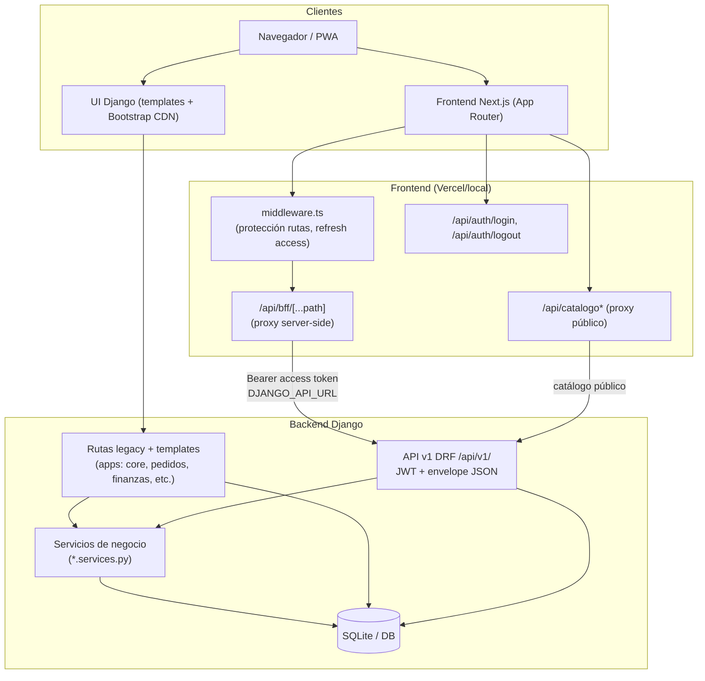
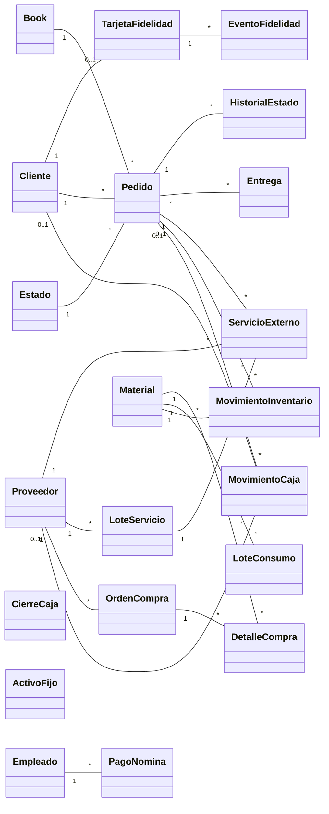
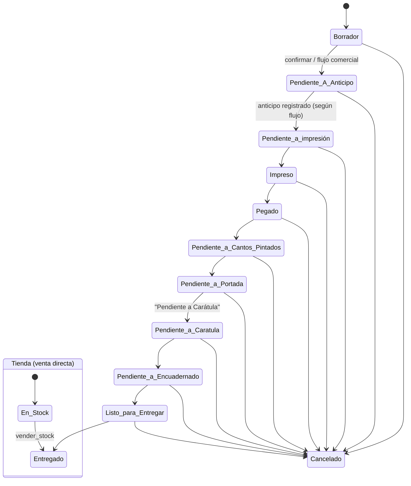

# ERP Vargas Editorial

Sistema ERP para la gestión de una editorial/encuadernación: catálogo de libros, pedidos y producción, inventario, compras/proveedores, finanzas multi-moneda, empleados, fidelidad de clientes y dashboard analítico. El proyecto combina una aplicación Django tradicional (templates server-side + Bootstrap por CDN) con una API v1 (Django REST Framework + JWT) consumida por un frontend Next.js mediante un BFF.

> **Idioma de negocio/UI:** español.  
> **Zona horaria operativa:** `America/Havana` (`USE_TZ=True`).

---

## Tabla de contenidos

- [Parte A — Documentación técnica](#parte-a--documentación-técnica)
  - [1. Visión general](#1-visión-general)
  - [2. Stack tecnológico](#2-stack-tecnológico)
  - [3. Estructura del repositorio](#3-estructura-del-repositorio)
  - [4. Arquitectura](#4-arquitectura)
  - [5. Configuración y variables de entorno](#5-configuración-y-variables-de-entorno)
  - [6. Instalación y ejecución](#6-instalación-y-ejecución)
  - [7. Comandos útiles](#7-comandos-útiles)
  - [8. Modelo de datos (resumen por dominio)](#8-modelo-de-datos-resumen-por-dominio)
  - [9. Rutas y API](#9-rutas-y-api)
  - [10. Frontend Next.js y BFF](#10-frontend-nextjs-y-bff)
  - [11. Autenticación y autorización](#11-autenticación-y-autorización)
  - [12. Despliegue e integraciones](#12-despliegue-e-integraciones)
  - [13. Scripts y utilidades](#13-scripts-y-utilidades)
  - [14. Estado técnico, gotchas y pendientes](#14-estado-técnico-gotchas-y-pendientes)
- [Parte B — Reglas de negocio y dominio](#parte-b--reglas-de-negocio-y-dominio)
  - [15. Glosario](#15-glosario)
  - [16. Catálogos y parámetros](#16-catálogos-y-parámetros)
  - [17. Flujo de pedidos y estados](#17-flujo-de-pedidos-y-estados)
  - [18. Costeo, precios y mensajería](#18-costeo-precios-y-mensajería)
  - [19. Inventario y consumo de materiales](#19-inventario-y-consumo-de-materiales)
  - [20. Finanzas, caja y divisas](#20-finanzas-caja-y-divisas)
  - [21. Fidelidad de clientes](#21-fidelidad-de-clientes)
  - [22. Clientes y segmentación](#22-clientes-y-segmentación)
  - [23. Proveedores, servicios externos, lotes y compras](#23-proveedores-servicios-externos-lotes-y-compras)
  - [24. Dashboard, KPIs y exportación IA](#24-dashboard-kpis-y-exportación-ia)
  - [25. Validaciones y restricciones](#25-validaciones-y-restricciones)
  - [26. Matriz de permisos y acceso](#26-matriz-de-permisos-y-acceso)
  - [27. Casos borde](#27-casos-borde)
  - [28. Supuestos y puntos por confirmar](#28-supuestos-y-puntos-por-confirmar)

---

# Parte A — Documentación técnica

## 1. Visión general

El ERP cubre el ciclo operativo de una encuadernación/editorial:

- **Catálogo**: libros (`Book`) con metadatos, precio base e imágenes.
- **Pedidos**: creación, seguimiento por estados, anticipo/saldo, descuentos/bonos, historial, servicios externos, lotes de servicio, entregas y venta de stock en tienda.
- **Inventario**: materiales, movimientos (entrada/salida/ajuste), lotes de consumo fraccionados y control de stock.
- **Compras**: órdenes de compra a proveedores de materiales, recepción e impacto en inventario/caja.
- **Proveedores**: directorio, cuentas por pagar y pagos de servicios externos (portadas, encuadernación, cantos).
- **Finanzas**: caja en CUP/USD, ingresos/egresos, arqueos, activos fijos/depreciación, compra/venta de divisas, reportes y utilidades.
- **Empleados**: nómina y pagos (salario/utilidades).
- **Clientes**: perfil, historial, segmentación (badges) y tarjeta de fidelidad pública por token.
- **Dashboard**: KPIs de resumen, producción, clientes y fidelidad; exportación de datos para análisis IA.

La lógica de negocio relevante reside principalmente en servicios (`core/services.py`, `pedidos/services.py`, `finanzas/services.py`, `clientes/services.py`, `inventario/services.py`, etc.), no en las vistas.

## 2. Stack tecnológico

### Backend
- **Python / Django 5.2** (proyecto en `config/`).
- **Base de datos (dev):** SQLite (`db.sqlite3`).
- **API:** Django REST Framework + `djangorestframework-simplejwt` (incluye blacklist/rotación configurada).
- **CORS:** `django-cors-headers`.
- **Configuración por entorno:** `python-dotenv` (`.env` cargado en `settings.py`).
- **Archivos estáticos:** WhiteNoise (`whitenoise.middleware.WhiteNoiseMiddleware`).
- **Imágenes/PDF/QR (dependencias declaradas):** `Pillow>=10.0.0`, `qrcode[pil]>=8.0`.
- **Generación PDF:** uso de `weasyprint` en vistas/servicios (p.ej. catálogo/órdenes/impresiones) — ⚠️ *verificar instalación en el entorno; no aparece en `requirements.txt` actual*.
- **PWA:** app `pwa` configurada en settings (manifest/iconos/tema).

### Frontend
- **Next.js 16.4.4** (App Router) + **React 19.3.0** + **TypeScript 5**.
- **UI/estilos:** Tailwind CSS 4.
- **Librerías:** `recharts`, `framer-motion`, `lucide-react`, `react-select`.
- **Integración backend:** proxy BFF en `app/api/bff/[...path]/route.ts` hacia `DJANGO_API_URL`.

### Otros componentes presentes
- App `agente_analista` (chat/endpoint de análisis; usa servicios y prompts internos).
- Rutas legacy de API por app (`/api/core/`, `/api/clientes/`, etc.) además de `/api/v1/`.
- Plantillas Django en `templates/` (raíz) y estáticos en `static/` (imágenes).

> ⚠️ **Dependencias:** `requirements.txt` en raíz solo lista `Pillow` y `qrcode[pil]`. El código/settings requieren paquetes adicionales (Django, DRF, SimpleJWT, corsheaders, python-dotenv, whitenoise, etc.). Usar el entorno/venv del proyecto o completar dependencias según el entorno real.

## 3. Estructura del repositorio

```text
erp_vargas_editorial/
├── config/                 # Proyecto Django: settings, urls, wsgi/asgi
├── core/                   # Dashboard, parámetros, ubicaciones, middleware, export IA
├── pedidos/                # Libros, pedidos, estados, servicios externos, lotes, entregas, costeo
├── clientes/               # Clientes, fidelidad, segmentación
├── inventario/             # Materiales, lotes de consumo, movimientos de inventario
├── finanzas/               # Caja, arqueos, activos, depreciación, divisas, reportes
├── compras/                # Órdenes de compra y recepción
├── proveedores/            # Proveedores y cuentas por pagar de servicios externos
├── empleados/              # Empleados y pagos de nómina/utilidades
├── agente_analista/        # Chat/agente analista financiero
├── api/                    # API v1 (urls, views, serializers, auth, exceptions)
├── templates/              # Plantillas Django (server-side)
├── static/                 # Recursos estáticos (imágenes/iconos)
├── frontend/               # Aplicación Next.js (App Router, BFF, UI)
├── para el env pythonanywhere/
├── manage.py
├── requirements.txt
├── db.sqlite3              # Base de datos local (dev)
└── scripts y utilidades en raíz (*.py, *.xlsx/json/pdf, etc.)
```

## 4. Arquitectura



**Notas:**
- El frontend usa cookies HttpOnly (`erp_access`, `erp_refresh`) y un BFF para adjuntar el JWT a Django.
- Conviven rutas/UI legacy y la nueva API v1; ambas comparten modelos y servicios.
- `core.middleware.ActualizarTasaDiariaMiddleware` se ejecuta en el pipeline de Django (actualización de tasa diaria según implementación del middleware).

## 5. Configuración y variables de entorno

### Backend (`.env` en raíz, cargado por `config/settings.py`)

| Variable | Descripción | Valor por defecto / nota |
|---|---|---|
| `SECRET_KEY` | Clave secreta Django | Fallback temporal de desarrollo si no se define |
| `DEBUG` | Modo debug (`'true'`/`'false'`) | `False` |
| `ALLOWED_HOSTS` | Hosts permitidos (CSV) | `localhost,127.0.0.1` |
| `FRONTEND_URL` | URL del frontend | `https://erp-vargas-editorial.vercel.app` |
| `CORS_ALLOWED_ORIGINS` | Orígenes CORS (CSV) | `http://localhost:3000,http://127.0.0.1:3000` |
| `CORS_ALLOWED_ORIGIN_REGEXES` | Regex de orígenes CORS (CSV) | vacío |
| `CSRF_TRUSTED_ORIGINS` | Orígenes CSRF confiables (CSV) | igual a `CORS_ALLOWED_ORIGINS` |
| `JWT_ACCESS_MINUTES` | Vida del access token | `15` |
| `JWT_REFRESH_DAYS` | Vida del refresh token | `7` |
| `ALMACENERO_NOMBRE` | Nombre por defecto para documentos/órdenes | vacío |
| `CEO_NOMBRE` | Nombre por defecto para documentos/órdenes | vacío |

**Configuración destacada:**
- `LANGUAGE_CODE='es'`, `TIME_ZONE='America/Havana'`, `USE_TZ=True`.
- DB: SQLite `BASE_DIR/db.sqlite3`.
- `REST_FRAMEWORK`: autenticación `JWTAuthentication` + `SessionAuthentication`; permiso por defecto `IsAuthenticated`; handler `api.v1.exceptions.custom_exception_handler`.
- `SIMPLE_JWT`: rotación y blacklist de refresh tokens habilitadas, `UPDATE_LAST_LOGIN=True`.
- PWA configurada (`PWA_APP_*`, iconos en `static/img/...`).

### Frontend (`frontend/.env.local` u entorno de despliegue)

| Variable | Uso |
|---|---|
| `DJANGO_API_URL` | URL base de API v1 para el BFF server-side (ej. `http://127.0.0.1:8000/api/v1`) |
| `NEXT_PUBLIC_DJANGO_URL` | URL pública del backend Django (usos client-side según componentes; ej. export/dashboard) |
| `NEXT_PUBLIC_BFF_BASE_URL` | Base del BFF en cliente (por defecto `/api/bff` si no se define) |
| `JWT_ACCESS_COOKIE_NAME` / `JWT_REFRESH_COOKIE_NAME` | Nombres de cookies JWT (defaults: `erp_access`, `erp_refresh`) |
| `JWT_ACCESS_MINUTES` / `JWT_REFRESH_DAYS` | Duración de cookies/refresh en frontend (alinear con backend) |
| `VERCEL_BYPASS_SECRET` | Header de bypass de protección Vercel si aplica (server-side en `apiFetch`) |

> ⚠️ Revisar coherencia entre `DJANGO_API_URL` (BFF), `NEXT_PUBLIC_DJANGO_URL` y el entorno real de despliegue para evitar descargas/exportaciones apuntando al host incorrecto.

## 6. Instalación y ejecución

### Requisitos previos
- Python 3.x (el proyecto incluye `venv/` de Windows en algunos checkouts; en Linux/WSL crear un venv propio).
- Node.js/npm para el frontend.
- Dependencias del sistema para WeasyPrint si se usan PDFs (Cairo/Pango/etc.) — ⚠️ según entorno.

### Backend (Django)

```bash
# Ejemplo en Linux/WSL (crear venv propio)
python -m venv .venv
source .venv/bin/activate
pip install -r requirements.txt  # ⚠️ incompleto: instalar además Django/DRF/JWT/corsheaders/dotenv/whitenoise/etc. según entorno
# Si requirements.txt está en UTF-16 LE y pip falla: convertir a UTF-8

# Configurar .env (SECRET_KEY, DEBUG=True para desarrollo, ALLOWED_HOSTS, etc.)

python manage.py migrate
python manage.py check
python manage.py runserver
```

```powershell
# Windows (si existe venv del repo)
venv\Scripts\python.exe manage.py migrate
venv\Scripts\python.exe manage.py check
venv\Scripts\python.exe manage.py runserver
```

### Frontend (Next.js)

```bash
cd frontend
npm install
# Configurar frontend/.env.local
npm run dev      # desarrollo
npm run build    # build de producción
npm run start    # servir build
```

### Verificación recomendada
- Backend: `python manage.py check`, `python manage.py makemigrations --check --dry-run`.
- Frontend: `npx tsc --noEmit`, `npm run build`.

## 7. Comandos útiles

| Comando | Descripción |
|---|---|
| `python manage.py runserver` | Ejecuta servidor Django en desarrollo |
| `python manage.py check` | Verifica configuración/problemas del proyecto |
| `python manage.py migrate` | Aplica migraciones |
| `python manage.py makemigrations --check --dry-run` | Comprueba migraciones pendientes |
| `python manage.py test` | Ejecuta tests (actualmente stubs, sin cobertura real significativa) |
| `python manage.py depreciar --anio 2026 --mes 11` | Comando de gestión para depreciación (si está implementado/disponible en el entorno) |

> No hay lint, typecheck ni formateador configurados en backend. Validar cambios con `check` y pruebas manuales de las vistas/flujos afectados.

## 8. Modelo de datos (resumen por dominio)



### `core`
- **`Parametro`** (`clave` PK, `valor`, `descripcion`, `fecha_actualizacion`): configuración clave-valor de negocio. Acceso típico `Parametro.get(clave, default)`.
- **Ubicaciones** (`core/ubicaciones.py`): provincias y municipios soportados.

### `clientes`
- **`Cliente`**: datos de contacto/ubicación (`provincia`, `municipio`), notas; propiedades financieras y de segmentación (`badge`, totales, días sin comprar).
- **`TarjetaFidelidad`**: `sellos`, `bono_saldo`, `token` UUID público, fechas.
- **`EventoFidelidad`**: `OTORGAMIENTO`, `CANJE`, `EXPIRACION`, cantidad, pedido opcional.

### `pedidos`
- **`Book`**: catálogo (título, autor, páginas, precio, descripción/notas, `disponible`, imágenes: `imagen` + URLs `imagen_base/con_esquineros/con_cantos`).
- **`Estado`**: nombre único, color, orden, `es_final`, activo.
- **`CodigoDescuento`**: porcentaje, vigencia, usos, categoría opcional.
- **`Pedido`**: cliente (nullable para stock/tienda), libro, cantidad, acabados, precios/anticipo/saldo, estado, fechas, entrega, descuento/bono/sellos fidelidad, `referencia_externa`, `es_historico`.
- **`HistorialEstado`**: trazabilidad de cambios de estado.
- **`ServicioExterno`**: servicios tercerizados (portada, encuadernado, cantos, etc.) con proveedor, monto y estado.
- **`LoteServicio`**: agrupación de servicios por proveedor/tipo con numeración automática.
- **`Entrega`**: agrupa múltiples pedidos de un cliente, dirección/ubicación, mensajería y confirmación.

### `inventario`
- **`Material`**: stock, unidad, costo promedio, mínimos, fraccionamiento (`unidad_consumo`, `cantidad_por_unidad`, `stock_consumo`).
- **`LoteConsumo`**: lotes fraccionados (cerrado/en uso/agotado).
- **`MovimientoInventario`**: `ENTRADA`/`SALIDA`/`AJUSTE`, cantidad, costos, pedido/proveedor/usuario/motivo. Actualiza stock y costo promedio en `save()`.

### `compras`
- **`OrdenCompra`**: proveedor, fechas, estado (`BORRADOR`/`RECIBIDA`/`CANCELADA`), total.
- **`DetalleCompra`**: material, cantidad, costo unitario, subtotal.

### `proveedores`
- **`Proveedor`**: tipo (imprenta portada, encuadernador, cantos pintados, papelería, otro), contacto, activo.

### `finanzas`
- **`MovimientoCaja`**: ingreso/egreso, categoría, monto, moneda (`CUP`/`USD`), método, concepto, vínculos a pedido/proveedor/cliente.
- **`CierreCaja`**: arqueo con saldos sistema/real y diferencia en CUP/USD, desglose por billetes/transferencia.
- **`ActivoFijo`** y **`Depreciacion`**: control patrimonial y depreciación registrada/calculada.
- **`GastoOperativo`**: registro de gastos imputables por mes.
- **`LoteDivisa`** y **`DetalleVentaDivisa`**: inventario de USD y consumo FIFO en ventas.

### `empleados`
- **`Empleado`**: datos, cargo, salario base, activo.
- **`PagoNomina`**: pagos tipo salario/utilidades, moneda/tasa, mes correspondiente.

## 9. Rutas y API

### Rutas principales legacy (`config/urls.py`)
- `/admin/` — administración Django.
- `/login/`, `/logout/` — autenticación Django.
- `/` — incluye `pwa.urls` y rutas de `core`.
- `/agente/`, `/pedidos/`, `/inventario/`, `/finanzas/`, `/clientes/`, `/proveedores/`, `/empleados/`, `/compras/`.
- `/api/v1/` — API v1.
- `/api/core/`, `/api/clientes/`, `/api/finanzas/`, `/api/empleados/`, `/api/inventario/`, `/api/proveedores/`, `/api/compras/` — endpoints legacy por app.
- `/api/` — router DRF legacy (incluye `pedidos`).

### API v1 (`api/v1/urls.py`, prefijo `/api/v1/`)
**Auth**
- `POST /auth/token/` — obtener tokens (SimpleJWT).
- `POST /auth/refresh/` — refresh estándar.
- `POST /auth/refresh-access/` — refresh de access token (vista custom).
- `POST /auth/verify/` — verificación de token.
- `GET /auth/me/` — usuario autenticado.

**Dashboard / analítica**
- `GET /dashboard/` y variantes `/dashboard/resumen|produccion|clientes|fidelidad/`.
- `GET /exportar-ia/` — exportación consolidada para IA.

**Públicos**
- `GET /fidelidad/publica/<uuid:token>/`
- `GET /catalogo/` — admite `q`, `page`, `per_page`, `ordering=random|-ventas`, `seed` (para paginación aleatoria estable).
- `GET /catalogo/libros/<id>/`, `GET /catalogo/libros/<id>/recomendaciones/`

**Operación (autenticados, selección principal)**
- **Pedidos:** viewset `/pedidos/` (+ acciones/endpoints definidos en `api/v1/views.py`).
- **Clientes/Libros/Empleados/Proveedores:** viewsets registrados en router.
- **Tienda:** `/tienda/`, `/tienda/<id>/vender/`.
- **Entregas:** listado, crear, pedidos disponibles, detalle, confirmar.
- **Inventario:** listado, registrar movimiento, historial por material, orden de trabajo.
- **Proveedores/lotes:** lotes por proveedor, pagar lote, orden PDF/documento.
- **Finanzas:** activos (CRUD parcial), caja/resumen/movimientos, arqueos, compra/venta de divisas.

> La respuesta API v1 usa un formato de envoltorio (`ok`, `data`, paginación/errores según caso) y un manejador de excepciones personalizado.

## 10. Frontend Next.js y BFF

### Estructura de rutas (`frontend/app`)
Incluye (entre otras):
- Públicas: `/login`, `/catalogo`, `/catalogo/[id]`, `/catalogo/checkout`, `/fidelidad`, `/fidelidad/[token]`.
- Privadas: `/` (dashboard), `/clientes`, `/pedidos`, `/libros`, `/tienda`, `/entregas`, `/inventario`, `/proveedores`, `/empleados`, `/finanzas/*` (caja, arqueos, activos, divisas), etc.
- Rutas API Next: `/api/auth/login`, `/api/auth/logout`, `/api/bff/[...path]`, `/api/catalogo`, `/api/catalogo/[...path]`.

### BFF y autenticación frontend
- **`middleware.ts`**: permite rutas públicas (`/login`, `/catalogo`, `/catalogo/*`, `/fidelidad/*`, `/api/*`); para el resto exige access token válido o intenta refresh con refresh token; redirige a `/login?next=...` si no hay sesión válida.
- **Cookies JWT**: `erp_access` y `erp_refresh` (HttpOnly, `sameSite=lax`, `secure` en producción), gestionadas en `lib/authCookies.ts`.
- **BFF (`/api/bff/[...path]`)**: reenvía requests al backend (`DJANGO_API_URL`), añade `Authorization: Bearer <access>`, refresca access token si es necesario y propaga respuesta/cookies.
- **Cliente API (`lib/api.ts`)**: en browser llama al BFF (`/api/bff`), en server llama directo a `DJANGO_API_URL` con token de cookie; valida envoltorio `{ok,data}`.

### Catálogo storefront (frontend)
- **`/catalogo`**: tienda organizada en recomendaciones personalizadas (favoritos en `localStorage` + endpoint de recomendaciones, fallback a populares), carrusel “Más vendidos” (top 10 por `ordering=-ventas`) y “Todos los libros” con carga infinita aleatoria estable por `seed` en `sessionStorage`.
- **`/catalogo/[id]`**: detalle público del libro con metadata OG/Twitter (imagen del libro y descripción para compartir), aviso legal de producto artesanal, CTA “Volver a la tienda” y “Agregar al carrito”; incluye recomendaciones/favoritos.
- **Componentes:** `ShopBookCard` navega al detalle (también soporta `onClick` cuando se requiere) y preserva la acción de favoritos; `BookCatalog` enlaza tarjetas al detalle.

### Imágenes de libros
- El frontend contempla imágenes remotas/URLs (`imagen_base`, `imagen_con_esquineros`, `imagen_con_cantos`) y normalización de enlaces (Drive/Dropbox) en utilidades/componentes (`frontend/lib/libros.ts`, `components/libros/BookImage.tsx`, `next.config.ts` remotePatterns) según implementación del proyecto.

## 11. Autenticación y autorización

- **Backend Django:** login/logout por sesión para UI legacy; admin Django habilitado.
- **API v1:** JWT (SimpleJWT) como mecanismo principal; DRF configurado por defecto con autenticación JWT + sesión y permiso `IsAuthenticated`.
- **Roles/grupos:** `api/v1/views.py` expone rol derivado (`admin` si superuser, `staff` si staff, nombre del primer grupo o `usuario`); algunos flujos usan grupos/nombres configurados (`ALMACENERO_NOMBRE`, `CEO_NOMBRE`) para documentos.
- **Acceso público:** endpoints de catálogo y fidelidad pública en API v1; rutas públicas correspondientes en frontend.
- **⚠️ Matriz detallada por endpoint/vista legacy:** no exhaustiva en este documento; validar decoradores/permisos caso por caso.

## 12. Despliegue e integraciones

- **Backend:** preparado para configuración por entorno (`.env`) y despliegue tipo PythonAnywhere (existe carpeta `para el env pythonanywhere/` con artefactos de apoyo).
- **Frontend:** orientado a despliegue en Vercel (URLs/CORS/headers contemplados).
- **PWA:** configuración en `settings.py` (nombre, colores, iconos, display standalone).
- **Wrapper móvil/APK (según notas del proyecto):** se ha utilizado configuración tipo Capacitor apuntando al sitio remoto; ⚠️ `capacitor.config.json` no se encontró en la raíz del checkout actual.

## 13. Scripts y utilidades

En la raíz existen scripts y archivos de soporte (migración/corrección de datos, generación de documentos, datos fuente como Excel/JSON/PDF). Ejemplos: `inicializar_db.py`, `migrar_pedidos.py`, `corregir_referencias.py`, `limpiar_referencias.py`, `limpiar_montos_pedidos.py`, `limpiar_migraciones.py`, `generar_manual.py`, `actualizar_libros.py`.

> ⚠️ **Precaución:** algunos scripts son de uso puntual y pueden borrar/modificar datos o registros de migraciones. Revisar el contenido antes de ejecutarlos y **no usarlos en producción** sin respaldo y validación explícita.

## 14. Estado técnico, gotchas y pendientes

- **Migración pendiente:** `pedidos/migrations/0019_book_imagenes_url.py` existe en el árbol pero puede no estar aplicada en la BD actual; faltaría aplicar migraciones y poblar `imagen_base` en libros existentes.
- **Migraciones ignoradas en git (según AGENTS del repo):** `pedidos/migrations/0012_pedido_es_historico.py` y `finanzas/migrations/0012_alter_movimientocaja_categoria.py` pueden estar en `.gitignore` aunque el esquema/modelos dependan de ellas. Verificar en clones nuevos.
- **Working tree sucio:** pueden existir cambios locales no confirmados y archivos CRLF reportados como modificados; evitar `git add -A`.
- **Tests:** `manage.py test` no cubre comportamiento real de forma significativa (stubs).
- **Calidad de código:** sin lint/typecheck/formateador configurados.
- **Dependencias backend incompletas en `requirements.txt`:** instalar/verificar paquetes reales del entorno.
- **Consistencia de entornos frontend:** validar `DJANGO_API_URL` vs `NEXT_PUBLIC_DJANGO_URL` para exportaciones y descargas.
- **API legacy `/api/pedidos/`:** revisar exposición/permisos efectivos en el entorno objetivo.
- **Cache dashboard:** `core/views.py` cachea contexto (5 min) y `core/api.py` usa versión de cache (`DASHBOARD_CACHE_VERSION`); cambios de datos pueden tardar en reflejarse.

---

# Parte B — Reglas de negocio y dominio

## 15. Glosario

| Término | Definición |
|---|---|
| **Libro (`Book`)** | Elemento de catálogo con título, páginas, precio base e imágenes; base para costeo y pedidos. |
| **Pedido** | Solicitud de producción/venta de un libro para un cliente (o stock/tienda si no tiene cliente). Contiene estado, precios, anticipo, saldo, acabados y fechas. |
| **Estado** | Etapa del flujo de un pedido (configurable en BD). El nombre exacto dispara automatizaciones. |
| **Tienda** | Conjunto de pedidos en estado `En Stock` sin cliente asignado, disponibles para venta directa. |
| **Servicio externo** | Trabajo tercerizado asociado a un pedido (portada, encuadernado, cantos pintados, etc.). |
| **Lote de servicio** | Agrupación de servicios externos del mismo proveedor y tipo para gestión/pago conjunto. |
| **Entrega** | Conjunto de pedidos listos para entregar a un mismo cliente, con mensajería y confirmación/cobro. |
| **Parámetro** | Valor configurable de negocio almacenado en `core.Parametro` (clave-valor). |
| **Anticipo** | Monto abonado por el cliente antes de completar el pago. |
| **Saldo pendiente** | `precio_venta - anticipo_recibido` (recalculado al guardar el pedido). |
| **Movimiento de caja** | Registro financiero de ingreso/egreso en CUP o USD con categoría y vínculos. |
| **Arqueo/Cierre de caja** | Comparación entre saldo del sistema y efectivo real (CUP/USD), con diferencias. |
| **Lote de divisa** | Compra de USD a una tasa específica; se consume por FIFO al vender divisas. |
| **Tarjeta de fidelidad** | Acumulación de sellos y bono para un cliente, consultable por token público. |
| **Referencia externa** | Identificador numérico heredado del sistema anterior (histórico/migración). |

## 16. Catálogos y parámetros

### Ubicaciones
- **Provincias soportadas:** La Habana, Artemisa (`core/ubicaciones.py`).
- **Municipios:** listados por provincia; usados para inferencia de ubicación y costos de mensajería.

### Estados de pedido (nombres observados/relevantes)
Estados definidos/esperados en BD (según contexto del proyecto): `Borrador`, `Pendiente a Anticipo`, `Pendiente a impresión`, `Impreso`, `Pegado`, `Pendiente a Cantos Pintados`, `Pendiente a Portada`, `Pendiente a Carátula`, `Pendiente a Encuadernado`, `Listo para Entregar`, `Entregado`, `Cancelado`.

Además, el código opera con **`En Stock`** para pedidos de tienda (sin cliente). ⚠️ Verificar que exista como `Estado` en BD.

### Parámetros de negocio (`core.Parametro`)
Se consultan con `Parametro.get(clave, default)`. Claves usadas en costeo/operación (ejemplos observados):

| Clave (ejemplos) | Uso |
|---|---|
| `paginas_por_hoja`, `precio_papel_paquete`, `hojas_por_paquete` | Costo de papel |
| `precio_tinta_litro`, `rinde_tinta_paginas` | Costo de tinta |
| `precio_pegamento`, `rinde_pegamento_lomos` | Costo de pegamento |
| `precio_esquineros_paquete_usd`, `esquineros_por_paquete`, `esquineros_por_libro` | Costo de esquineros |
| `precio_cantos_pintados` / `precio_scotch` | Costos de cantos/acabados (según flujo) |
| `precio_portada` | Costo/servicio de portada |
| `precio_encuadernacion`, `precio_encuadernacion_grueso`, `paginas_para_grueso` | Encuadernación |
| `electricidad_mensual`, `libros_por_mes_estimado` | Costo eléctrico prorrateado |
| `precio_diseno` | Costo de diseño |
| `paginas_min`, `paginas_max`, `margen_min`, `margen_max` | Cálculo de margen y precio sugerido |
| `Tasa_cambio` | Tasa CUP/USD usada en cálculos/finanzas |
| `fidelidad_sellos_meta`, `fidelidad_bono_monto`, `fidelidad_dias_expiracion` | Fidelidad |

> La lista no es exhaustiva; los parámetros disponibles dependen de los registros cargados en BD.

### Catálogos/categorías financieras (MovimientoCaja)
- **Tipos:** `INGRESO`, `EGRESO`.
- **Monedas:** `CUP`, `USD`.
- **Métodos:** efectivo, transferencia, tarjeta, otro.
- **Categorías relevantes:** anticipos/saldos de cliente, venta directa, mensajería, propina, compra de material/activo, gasto operativo, nómina/retiro utilidades, pago proveedor, compra/venta de divisa, ganancia/pérdida cambiaria, ajustes de arqueo, vuelto a cliente, etc.

## 17. Flujo de pedidos y estados

### Reglas generales
- `Pedido.save()` recalcula siempre: `saldo_pendiente = precio_venta - anticipo_recibido`.
- El historial de estados registra cambios (`HistorialEstado`).
- Los servicios automáticos dependen del **nombre exacto** del estado destino.

### Automatizaciones por transición (según `pedidos/services.py`)
- **`Pendiente a Cantos Pintados`** → crea `ServicioExterno` de cantos pintados (si no existe) y lo asocia a lote/proveedor correspondiente.
- **`Pendiente a Carátula`** → crea servicio externo de portada.
- **`Pendiente a Encuadernado`** → crea servicio externo de encuadernado.
- **`Listo para Entregar`** → consume materiales del pedido (momento entrega, según lógica de inventario).
- **`Entregado`** → registra fecha real de entrega, gestiona relación con entrega (si aplica), cobra saldo pendiente y desencadena efectos asociados (p.ej. fidelidad al registrar compra en flujos correspondientes).

> ⚠️ Si se renombra un estado en BD, se rompe la automatización asociada a ese nombre.

### Diagrama de flujo (simplificado)



> El flujo real puede variar por operación manual/cambios masivos. La secuencia exacta operativa debe validarse contra los estados configurados en BD y las acciones disponibles en UI/API.

### Entregas
- Una `Entrega` agrupa varios pedidos de un **mismo cliente**.
- Solo se consideran pedidos aptos los que están `Listo para Entregar` y no pertenecen a otra entrega (validación en API v1).
- Al confirmar entrega se registra el pago/cobro correspondiente y se marcan pedidos como entregados (según servicio).

## 18. Costeo, precios y mensajería

### Costeo (`pedidos.services.CosteadorPedido`)
Componentes del costo (según parámetros y datos del pedido/libro):
- **Papel:** hojas necesarias según `paginas_por_hoja`, costo por hoja desde paquete.
- **Tinta:** costo por página según precio/rendimiento.
- **Pegamento:** prorrateo por lomos/rendimiento.
- **Esquineros:** costo en USD convertido a CUP por tasa (si lleva esquineros o cantos tintados, según lógica de acabados).
- **Cantos tintados (scotch/costo asociado):** si aplica.
- **Portada:** costo fijo parametrizado.
- **Encuadernación:** normal o gruesa según umbral de páginas.
- **Electricidad:** prorrateo mensual estimado.
- **Diseño:** costo parametrizado.

El costeador puede recibir `parametros` y `tasa_cambio` precargados; si no, consulta valores actuales.

### Precio sugerido
- Se parte de un costo base (excluyendo adicionales específicos de acabados en la lógica implementada) y se aplica un **margen variable** según cantidad de páginas entre `paginas_min/paginas_max` y `margen_min/margen_max`.
- Se redondea al múltiplo de 100 hacia arriba.
- Se suma incremento por acabado:
  - **Cantos tintados:** +3000 / +4000 / +5000 (según rango de precio base).
  - **Esquineros (sin cantos tintados):** +300 / +500 / +800.
- Rangos (precio base): `< 5000`, `< 8000`, `>= 8000`.

### Mensajería
- Costos definidos por municipio/provincia en `pedidos/services.py`.
- **Artemisa:** costo base 0 para municipios de Artemisa (según tabla).
- **La Habana:** costos específicos por municipio (ej. Centro Habana, Playa, etc.).
- Se normalizan nombres (tildes/mayúsculas/espacios) para buscar coincidencias; si no se reconoce municipio, costo sugerido 0 (salvo inferencias contempladas).

### Ingresos y descuentos
- Ingreso operativo del pedido: `precio_venta - descuento_aplicado` (criterio usado en analítica/dashboard).
- Se soportan códigos de descuento con vigencia/usos/categoría opcional y bonos de fidelidad aplicados al pedido.

## 19. Inventario y consumo de materiales

- **Materiales:** control de `stock_actual`, `stock_minimo`, `costo_promedio` y unidad de medida.
- **Fraccionamiento:** un material puede definir `unidad_consumo` y `cantidad_por_unidad`, generando/gestionando `stock_consumo` (lotes de consumo).
- **Movimientos (`MovimientoInventario`):**
  - `ENTRADA`: incrementa stock; recalcula costo promedio ponderado (según implementación en `save()`).
  - `SALIDA`: descuenta stock.
  - `AJUSTE`: fija stock al valor indicado.
  - Se registra `costo_total = cantidad * costo_unitario`.
- **Compras de material:** al registrar compras (según vista/flujo) se crea entrada de inventario y egreso de caja; puede generar lotes de consumo fraccionados.
- **Lotes de consumo:** estados `CERRADO`, `EN_USO`, `AGOTADO`; apertura de lote registra consumo/ajustes de stock de consumo según flujo implementado.
- **Consumo automático por pedido:** `ServicioInventario.consumir_materiales_pedido` consume **esquineros** al entregar cuando el pedido lleva esquineros o cantos tintados (cantidad parametrizable). Hojas, tinta y pegamento se controlan manualmente.

## 20. Finanzas, caja y divisas

### Principios
- **Multi-moneda:** `CUP` y `USD` en movimientos de caja.
- **Pagos en USD:** deben ser montos enteros (sin centavos); se convierten a CUP con tasa aplicada/actual.
- **Pagos mixtos:** combinación CUP/USD con cálculo de total equivalente, aplicado, vuelto/propina según contexto (venta/entrega).
- **Saldo de caja por moneda:** ingresos menos egresos, con posibilidad de excluir categorías (p.ej. transferencias de divisas).

### Movimientos y categorías
- Categorías distinguen operación comercial, compras, gastos, nómina, activos, divisas y ajustes.
- **Transferencias de divisa:** `COMPRA_DIVISA` y `VENTA_DIVISA` representan conversión entre monedas; en reportes/saldos operativos se excluyen para evitar doble conteo.
- **Vuelto a cliente:** `VUELTO_CLIENTE` se trata como egreso asociado que ajusta el ingreso neto en ciertos cálculos.

### Anticipos y reconocimiento
- Los anticipos (`ANTICIPO_CLIENTE`) vinculados a pedidos se consideran diferidos en analítica hasta condiciones de reconocimiento definidas en servicios de dashboard/finanzas (p.ej. entrega del pedido), según implementación de `core/services.py`.

### Divisas
- **Compra:** egresa CUP, ingresa USD y crea `LoteDivisa` con precio de compra.
- **Venta:** consume lotes por **FIFO**, registra egreso USD/ingreso CUP y calcula ganancia o pérdida cambiaria (`GANANCIA_CAMBIARIA` / `PERDIDA_CAMBIARIA`).

### Arqueos y activos
- **Arqueo (`CierreCaja`):** registra saldo sistema vs efectivo real en CUP/USD, diferencia y desglose de billetes/transferencia.
- **Activos fijos:** valor en libros y depreciación calculada por propiedades; existe registro de depreciaciones y comando/servicios asociados.
- **Utilidades disponibles:** cálculo por moneda considerando saldo físico y pasivos/compromisos operativos (anticipos, deudas/servicios impagos, etc.) según `ServicioFinanzas`.

## 21. Fidelidad de clientes

- Parámetros: meta de sellos (`fidelidad_sellos_meta`, default 10), bono (`fidelidad_bono_monto`, default 5000.00), expiración (`fidelidad_dias_expiracion`, default 90 días).
- Cada cliente puede tener `TarjetaFidelidad` con `token` público UUID.
- **Expiración:** si hay sellos y la última compra supera el plazo, los sellos expiran (se registran evento `EXPIRACION`).
- **Registro de compra:** otorga sellos (según cantidad del pedido) sin superar la meta; al alcanzar la meta otorga bono y registra `OTORGAMIENTO`. No otorga sellos si el pedido ya los tiene otorgados o si se aplicó bono de fidelidad.
- **Aplicación de bono:** descuenta del saldo de bono, reinicia sellos a 0 y registra `CANJE`.
- **Ajuste manual:** permite modificar sellos/bono con límites y actualiza fecha de última compra.

## 22. Clientes y segmentación

- **Badges (propiedad `Cliente.badge`, pedidos no cancelados):**
  - `Sin Pedidos` si no tiene pedidos.
  - `En Riesgo` si > 120 días sin comprar.
  - `Inactivo` si > 60 días sin comprar.
  - `Cliente VIP` si > 10 pedidos.
  - `Recurrente Activo` si 5–9 pedidos y la mayoría son recientes (últimos 60 días).
  - `Alto Valor` si promedio de libros por mes >= 2.
  - `Cliente Nuevo` si exactamente 1 pedido y <= 60 días.
  - `None` si no aplica ninguna etiqueta anterior.
- **Dashboard clientes:** alinea VIP a `> 10` pedidos no cancelados; prioriza `en_riesgo` cuando `dias_sin_comprar > 90` en la lógica de analítica (⚠️ umbral de dashboard puede diferir del badge de 120 días; verificar según `core/services.py`).
- Ubicación del cliente (`provincia`, `municipio`) puede inferirse desde dirección/notas para mensajería.

## 23. Proveedores, servicios externos, lotes y compras

- **Proveedores:** tipificados (imprenta portada, encuadernador, cantos pintados, papelería, otro).
- **Servicios externos:** creados automáticamente al avanzar estados del pedido (cantos, portada, encuadernado), con monto parametrizado y estado (`SOLICITADO`, `RECIBIDO`, `PAGADO`).
- **Lotes de servicio:** agrupan servicios por proveedor/tipo; se reutiliza lote abierto reciente (ventana de 2 horas) o se crea uno nuevo; numeración automática diaria/secuencial.
- **Cuentas por pagar:** servicios no pagados (`SOLICITADO`/`RECIBIDO`) generan deuda.
- **Pagos:** al pagar servicios se registran egresos en caja y se actualizan estados/fechas; puede cerrarse el lote cuando todos los servicios quedan pagados.
- **Órdenes de compra (materiales):** flujo `BORRADOR` → `RECIBIDA` (impacta inventario y caja) o `CANCELADA`.

## 24. Dashboard, KPIs y exportación IA

### Cortes y referencias
- **Corte financiero:** `FECHA_CORTE_FINANCIERO = 2026-08-02` (y referencia 487 en analítica financiera).
- **Corte ganancia promedio (costeo/pedidos):** `FECHA_CORTE_GANANCIA_PROMEDIO = 2026-08-02`.

### KPIs destacados (resumen)
- **`deuda_clientes`:** suma de `Pedido.saldo_pendiente` con cliente, saldo > 0, excluyendo estados `Cancelado` y `Borrador`.
- **`dinero_proyectado`:**  
  `saldo_caja_cup (equivalente/monedas) + deuda_clientes - costos_pendientes_estimados`  
  donde los costos pendientes se estiman por cantidad de pedidos en etapas previas:
  - antes de carátula (`ESTADOS_ANTES_CARATULA`) × 1080
  - antes de encuadernado (`ESTADOS_ANTES_ENCUADERNADO`) × 480
  - con cantos tintados antes de cantos (`ESTADOS_ANTES_CANTOS`) × 2500

### Producción y tiempos
- Estados considerados en orden de tiempo: `Pendiente a impresión`, `Impreso`, `Pegado`, `Pendiente a Cantos Pintados`, `Pendiente a Portada`, `Pendiente a Carátula`, `Pendiente a Encuadernado`.
- Tiempo en `Pendiente a impresión`: desde `fecha_pedido` hasta primera entrada en `Impreso` (historial). Otros intervalos: entre eventos de historial; si es el último estado medido, hasta `fecha_entrega_real` cuando aplica.

### Cache y exportación
- Dashboard API cachea datos por tab/rango/tasa con TTL (~5 min) y versión de cache (`DASHBOARD_CACHE_VERSION = 11`).
- **Exportación IA (`/exportar-ia/`, API v1):** JSON con `meta`, `dashboard` (resumen, producción, clientes, fidelidad) y `secciones_rentabilidad_ia` (rentabilidad agrupada por mes/estado/plan, márgenes por libro (top 30 + “Otros libros”), top clientes, deudores, nómina, servicios externos, flujo por moneda, fidelidad).
- **Rentabilidad IA (`/exportar/rentabilidad/`):** devuelve `meta`, `resumen_financiero`, `pedidos_activos`, `metricas_produccion`, `rentabilidad_por_plan` (Base/Medio/Premium inferidos por precio) y `clientes_en_riesgo` (>90 días sin pedidos). Los ingresos usan `precio_venta`, nunca solo el anticipo.

## 25. Validaciones y restricciones

- **Pagos:** montos > 0; USD en enteros (sin centavos); tasa de cambio válida y > 0 cuando aplica; no exceder saldo (salvo flujos que permiten vuelto/excedente según caso).
- **Pedido:** `saldo_pendiente` se recalcula en `save()`; venta en tienda requiere pedido `En Stock` sin cliente; cobro de saldo anticipado no permitido en pedidos históricos, entregados o sin saldo.
- **Entregas:** pedidos deben existir, no estar en otra entrega, estar `Listo para Entregar`, pertenecer al mismo cliente y tener cliente asignado; dirección requerida (del cliente o explícita).
- **Inventario:** salidas no deben superar stock disponible; ajustes no negativos; entradas con costo impactan valuación/caja según flujo.
- **Códigos de descuento:** vigencia por fechas, estado activo y límite de usos (cuando aplica).
- **Fidelidad:** sellos acotados por meta; bono no negativo.
- **Nombres de estado:** automatizaciones dependen de coincidencia exacta de `Estado.nombre`.

## 26. Matriz de permisos y acceso

| Área / recurso | Acceso | Mecanismo observado |
|---|---|---|
| Frontend `/login`, `/catalogo*`, `/fidelidad/*` | Público | `frontend/middleware.ts` permite acceso sin JWT |
| Frontend rutas operativas (`/`, `/pedidos`, `/finanzas`, etc.) | Autenticado | Middleware exige access token válido o refresh exitoso |
| API v1 `/auth/token|refresh|verify|refresh-access` | Público (para autenticarse/refrescar) | Endpoints de emisión/gestión JWT |
| API v1 `/catalogo*`, `/fidelidad/publica/<token>` | Público | `AllowAny` |
| API v1 resto de endpoints/viewsets (operación, dashboard, finanzas, inventario, etc.) | Autenticado | `IsAuthenticated` + JWT (configuración DRF/vistas) |
| Django Admin `/admin/` | Usuarios admin/staff Django | Permisos estándar de Django Admin |
| UI legacy Django (`/pedidos/`, `/finanzas/`, etc.) | Autenticación Django/sesión | Config `LOGIN_URL='login'`; ⚠️ verificar decoradores por vista |
| API legacy `/api/pedidos/` (router) | ⚠️ Por confirmar en entorno actual | Históricamente señalado como abierto por defaults; settings actuales definen `IsAuthenticated` por defecto en DRF |

**Roles en API v1 (`/auth/me/`):** `admin` (superuser), `staff`, nombre del primer grupo del usuario, o `usuario`.

## 27. Casos borde

- **Tienda:** se alimenta de `Pedido` con estado `En Stock` y `cliente = null`; no es inventar  io de `Book` directamente.
- **Pedidos sin ubicación identificable:** costo de mensajería sugerido 0 si no se puede inferir municipio.
- **Acabados:** cantos tintados implican esquineros en costeo/consumo según reglas implementadas.
- **Bono de fidelidad aplicado en pedido:** no se otorgan sellos por esa compra.
- **Pedido ya con sellos otorgados:** no se vuelven a otorgar.
- **Entrega con excedente de pago:** puede generar vuelto o propina según composición del pago (lógica en servicios financieros de entrega).
- **Divisas:** venta sin stock USD suficiente debe fallar; consumo de lotes en orden FIFO.
- **Anticipos en analítica:** pueden contabilizarse como diferidos hasta entrega (no como ingreso operativo inmediato) según cortes/reglas de dashboard.
- **Cache dashboard:** métricas pueden mostrarse desactualizadas hasta expirar cache o cambiar versión/parámetros.
- **Datos históricos:** pedidos marcados `es_historico` tienen restricciones (p.ej. cobro anticipado de saldo no permitido).

## 28. Supuestos y puntos por confirmar

- ⚠️ **Migraciones pendientes/aplicación en BD:** aplicar `0019_book_imagenes_url.py` y completar `imagen_base` en libros existentes.
- ⚠️ **Migraciones ignoradas por git:** confirmar presencia de migraciones históricas requeridas en clones nuevos.
- ⚠️ **Dependencias backend reales:** `requirements.txt` no refleja todas las librerías usadas (Django, DRF, SimpleJWT, corsheaders, dotenv, whitenoise, weasyprint, etc.).
- ⚠️ **Permisos de endpoints legacy:** revisar decoradores/permisos efectivos en todas las vistas y APIs antiguas.
- ⚠️ **Flujo exacto de estados operativo:** algunos estados existen en BD y otros se usan en código (`En Stock`, secuencias intermedias); validar contra datos reales y UI.
- ⚠️ **Consistencia de URLs frontend/backend:** `NEXT_PUBLIC_DJANGO_URL` y `DJANGO_API_URL` pueden apuntar a entornos distintos; verificar exportaciones/descargas desde dashboard.
- ⚠️ **Despliegue móvil/PWA avanzado:** existencia y vigencia de configuración Capacitor/APK en el checkout actual.
- ⚠️ **Cobertura de pruebas y calidad:** no hay suite de tests representativa ni tooling de lint/typecheck configurado.
- ⚠️ **Agente analista:** alcance funcional y dependencias externas (modelos/LLM/credenciales) no documentadas en código revisado aquí.

---

*Documento generado a partir del análisis del código y configuración presentes en el repositorio. Ante discrepancias con la operación real, prevalece el comportamiento del código, las migraciones aplicadas y los datos/configuración del entorno en ejecución.*

<!-- SUGERENCIA: agregar changelog -->